**Your semester. Your schedule. Your next move.**
🥉 3rd place, Hacktoberfest 2026

## 📥 Downloads

| File | Platform | How to install |
| :--- | :--- | :--- |
| `CampusIQ-*.apk` | 🤖 Android 7+ | Open on your phone, allow *install unknown apps*, tap **Install**. Future versions update in place and keep your data. |
| `CampusIQ-*.ipa` | 🍎 iPhone / iPad | **Unsigned.** Install with [AltStore](https://altstore.io) or [Sideloadly](https://sideloadly.io) using your Apple ID. |
| `CampusIQ-*-web.zip` | 🌐 Any browser | Already live at **https://priyanshusharan-cmd.github.io/campusiq/**, or unzip onto any static host (SPA rewrite `/*` → `/index.html`). |
| `SHA256SUMS.txt` | — | Checksums to verify your download. |

## ✨ What's inside

- 🗓️ **Timetable:** Monday–Sunday schedules, lecture and lab slots, rooms, dated extra classes
- ✅ **Attendance:** theory/lab split, targets, *safe to miss* and *must attend* math, what-if simulation
- 📊 **SGPA & CGPA:** credit-weighted scorecards, target-CGPA planner and an external-marks forecaster
- 📝 **Assignments & exams:** due-date urgency, countdowns, reminders and offline PDF exports
- ✨ **Gemma AI (optional):** chat, plus timetable and marksheet imports from a photo, with an editable review before anything is saved
- 🎨 **Light & dark mode,** course colors and icons, configurable grading schemes

## 🔒 Backend-free by design

- **No server, no account, no database, no analytics.** Your records live on your device.
- **No bundled API key.** AI only runs with *your* Google key or *your* Mac running Ollama.
- PDF exports and all calculations work fully offline.

## 🆕 In this release

- Redesigned **About** and **Privacy Policy** screens with an at-a-glance summary and collapsible sections
- Removed the build-time API key fallback, so builds are strictly bring-your-own-key
- PDF reports now use system fonts and need no internet
- New [user manual](https://github.com/priyanshusharan-cmd/campusiq/blob/main/docs/USER_MANUAL.md) and [privacy policy](https://github.com/priyanshusharan-cmd/campusiq/blob/main/docs/PRIVACY_POLICY.md)

📘 **New here?** Start with the [user manual](https://github.com/priyanshusharan-cmd/campusiq/blob/main/docs/USER_MANUAL.md). 🐞 Found a bug? [Open an issue](https://github.com/priyanshusharan-cmd/campusiq/issues).
