<div align="center">


<br />

**A college companion that turns scattered timetables, attendance records and marksheets into one clear picture of student life — with Gemma AI you can run in the cloud or on your own Mac.**

<br />


<br />

[**Explore**](#-a-look-inside) · [**Features**](#-built-around-your-semester) · [**AI imports**](#-from-a-screenshot-to-a-reviewable-proposal) · [**The math**](#-the-math-behind-the-numbers) · [**Gemma modes**](#-choose-where-gemma-runs) · [**Run it**](#-run-campusiq) · [**Architecture**](#-architecture) · [**Docs**](#-go-deeper)

<br />


</div>

<br />

## 📖 Table of contents

<details>
<summary><strong>Click to expand</strong></summary>

- [Why CampusIQ](#-why-campusiq)
- [A look inside](#-a-look-inside)
- [Built around your semester](#-built-around-your-semester)
- [From a screenshot to a reviewable proposal](#-from-a-screenshot-to-a-reviewable-proposal)
- [The math behind the numbers](#-the-math-behind-the-numbers)
- [Grades you can explore](#-grades-you-can-explore)
- [More screens, two personalities](#-more-screens-two-personalities)
- [Choose where Gemma runs](#-choose-where-gemma-runs)
- [Run CampusIQ](#-run-campusiq)
- [Put it online with Render](#-put-it-online-with-render)
- [Privacy, plainly](#-privacy-plainly)
- [Architecture](#-architecture)
- [Tech stack](#-tech-stack)
- [Repository map](#-repository-map)
- [Quality checks](#-quality-checks)
- [FAQ](#-faq)
- [Contributing](#-contributing)
- [Go deeper](#-go-deeper)

</details>


## 💡 Why CampusIQ

Every semester starts the same way: a timetable as a blurry photo in a group chat, attendance tracked in your head, and an SGPA you only find out about when results drop. College apps are usually built for the institution, not the student.

CampusIQ is built the other way round. It connects the practical parts of college life — **the class you need to attend, the attendance target you want to hold, and the grades you are working toward** — and answers the questions students actually ask:

> *“Can I skip tomorrow's lab?”* · *“How many classes do I need to get back to 75%?”* · *“What do I need in the externals to hit an 8.5?”* · *“Can you just read my timetable screenshot and set everything up?”*

Add information by hand, or let Gemma prepare an import from a photo — then **review every row before anything is saved**.


## 📱 A look inside

<table>
  <tr>
    <th>Start with your day</th>
    <th>See your schedule</th>
    <th>Stay on track</th>
  </tr>
  <tr>
    <td align="center">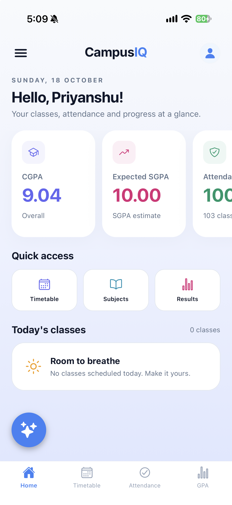</td>
    <td align="center">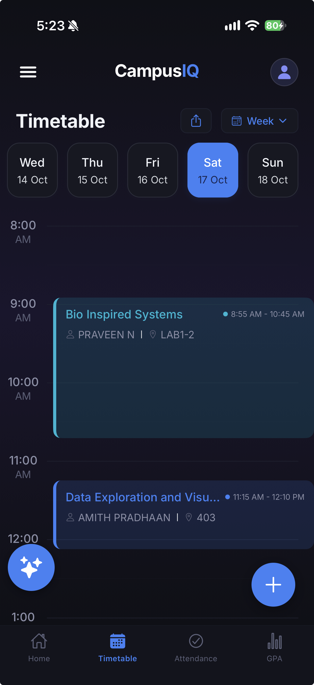</td>
    <td align="center"></td>
  </tr>
</table>

<p align="center"><strong>Less hunting through screenshots. More understanding what comes next.</strong></p>


## 🧭 Built around your semester


| Area | What you can do |
| :--- | :--- |
| 🏠 **Home** | Check academic stats, open your core tools and see today's classes at a glance, with a time-of-day greeting. |
| 🗓️ **Timetable** | Organize Monday–Sunday schedules, lecture and lab slots, rooms, weekly classes and dated extra classes. |
| 📚 **Subjects & Classes** | Keep course details together and browse classes grouped by subject in the Academic Hub. |
| ✅ **Attendance** | Track present, absent, cancelled and holiday records; inspect subject-level theory/lab attendance against your targets. |
| 📊 **SGPA & CGPA** | Maintain semester scorecards with course codes, credits, marks and grade points; track cumulative progress. |
| 🎯 **Grade forecasting** | Explore assessment components, subject goals, score projections and each course's effect on SGPA. |
| ✨ **AI assistance** | Ask academic questions, attach a timetable or marksheet and prepare supported app changes with conversation context. |
| 📝 **Assignments & exams** | Track deadlines and exams with due-date urgency, countdowns and supported device reminders. |
| 📤 **Exports** | Generate reports and share them through supported print, download and share flows. |
| 🎨 **Personalization** | Choose light/dark appearance, course colors and icons, college timings, attendance targets and grading settings. |

Onboarding walks you through your profile and subjects; a grading wizard sets up your college's scheme. Calendar exceptions and analytics round out the toolkit. Availability of device services varies by platform.


## ✨ From a screenshot to a reviewable proposal

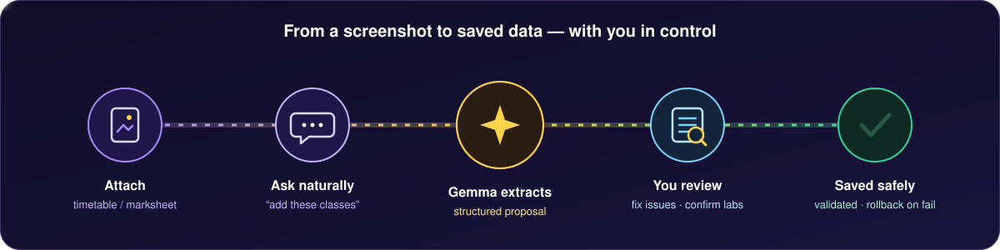

<table>
  <tr><th>Ask naturally</th><th>Enable app changes</th><th>Review the details</th></tr>
  <tr>
    <td align="center">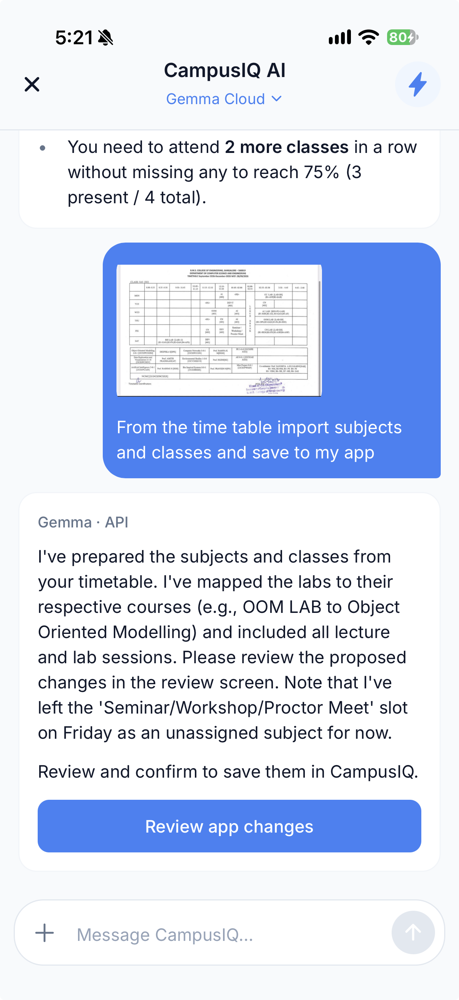</td>
    <td align="center"></td>
    <td align="center">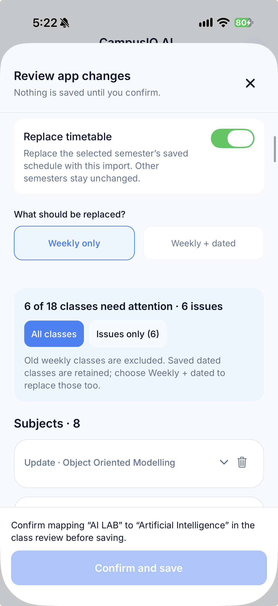</td>
  </tr>
</table>

1. **Attach the source.** Choose a photo, use supported image paste, or paste/drop an image in the browser. JPEG, PNG and WebP images are supported up to 3 MB.
2. **Say what you need.** For example: *“Add the subjects and faculty from this timetable,”* *“Update my weekly classes,”* or *“Import this marksheet into Semester 3.”* No special command syntax is required.
3. **Enable the ⚡ lightning control** for app changes. Ordinary questions can stay in regular chat.
4. **Review the proposal.** Check the semester, extracted fields, lecture/lab slots, suggested mappings and any unresolved conflicts. Date/time pickers make manual corrections explicit.
5. **Confirm and save.** The assistant prepares changes; the app validates and applies the reviewed proposal.

### 🛡️ Helpful automation, with the final say in your hands

| Behavior | Why it matters |
| :--- | :--- |
| **Reuses saved courses** through names, codes and unique abbreviations | No duplicate subjects after every import. |
| **Keeps lecture and lab sessions distinct**, with confirmation for suggested lab-to-course mappings | Theory and lab attendance stay separate and accurate. |
| **Checks ordered time headers** to resolve an unambiguous noon rollover when AM/PM is missing | `12, 1, 2` becomes afternoon only when the order proves it; ambiguous periods stay reviewable. |
| **Cleans exact duplicates and explicit time formats** without shifting a class to hide a real conflict | Real clashes are shown, never silently “fixed”. |
| **Shows issue counts and an *Issues only* filter** | Jump straight to the rows that need attention. |
| **Replaces the selected semester's schedule** with weekly-only or weekly-plus-dated scope | You choose exactly how much gets overwritten. |
| **Imports marksheet course rows independently** of the current Subjects list, including printed zero-credit courses | Zero-credit courses are recorded but don't affect GPA weighting. |
| **Uses recent chat context and the latest shared image** for follow-ups | *“Now do the lab batches too”* just works while the chat is open. |

Supported proposals also include class edits, attendance ranges, assignment and exam updates, semester results, calendar exceptions and allowlisted profile/preference changes. **Credentials, security controls, sharing, app-wide resets and custom grading configuration stay outside chat control.**

> [!WARNING]
> **AI can make mistakes.** A section, batch, merged cell, faculty name or grading rule can be misread. CampusIQ leaves genuine ambiguities for review rather than claiming every document is understood perfectly. A chat explanation is not proof that data was saved.


## 🧮 The math behind the numbers


CampusIQ's academic engine lives in [`src/lib`](src/lib) as small, pure, testable functions. No AI is involved in these calculations: they run locally and give the same answer every time.

<details open>
<summary><strong>✅ Attendance</strong> — <code>src/lib/attendanceUtils.ts</code></summary>
<br />

| Question | Calculation |
| :--- | :--- |
| Current percentage | `present / total × 100`, rounded to 2 decimals (100% before any class is recorded) |
| Classes needed to reach target `T` | `⌈ (T × total − 100 × present) / (100 − T) ⌉` |
| Classes you can still miss | The largest number of extra absences that keeps you at or above `T` |
| *What if I miss / attend n?* | `simulateAttendance()` and `simulateAttending()` project the new percentage before you decide |

**Example:** 21 present out of 30 (70%) with a 75% target → `⌈(75×30 − 100×21) / 25⌉ = 6` classes in a row to get back on track.

</details>

<details>
<summary><strong>📊 SGPA, CGPA and targets</strong> — <code>src/lib/gradeUtils.ts</code></summary>
<br />

| Metric | Calculation |
| :--- | :--- |
| **SGPA** | `Σ(grade point × credits) / Σ credits` for the semester |
| **CGPA** | `Σ(SGPA × semester credits) / Σ credits` across completed semesters |
| **Required SGPA for a target CGPA** | `(target × credits after sem − current CGPA × completed credits) / this semester's credits`, flagged as unachievable above 10 |
| **CGPA → percentage** | `(CGPA − 0.75) × 10` (approximate, a common conversion) |

</details>

<details>
<summary><strong>🎯 Forecasting externals</strong> — <code>calculateRequiredExternals()</code></summary>
<br />

Given your internal/lab marks, credits, maximum marks and grading scheme, the forecaster starts every subject at a passing grade point, then raises targets step by step until the total credit-weighted points reach your target SGPA. The result is the **easiest path**: the external marks each subject needs, according to your college's grade boundaries.

</details>

GPA calculations use the configured grading scheme and reviewed data. **Projections are estimates, not official college results.**


## 🏆 Grades you can explore

<table>
  <tr><th>Your semester story</th><th>Your course forecast</th><th>Every point has context</th></tr>
  <tr>
    <td align="center"></td>
    <td align="center">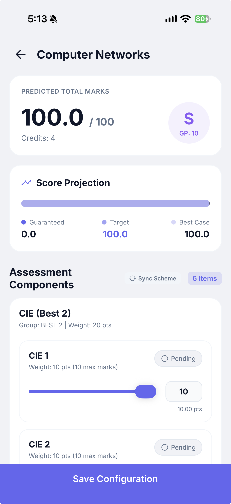</td>
    <td align="center"></td>
  </tr>
</table>

Keep a course-by-course record, explore a target and understand how each subject contributes to your semester.


## 🌗 More screens, two personalities

<details>
<summary><strong>☀️ Light & 🌙 dark — Home, Attendance, Timetable and GPA</strong></summary>
<br />
<table>
  <tr><th>Home</th><th>Attendance</th><th>Timetable</th><th>CGPA</th></tr>
  <tr>
    <td></td>
    <td></td>
    <td></td>
    <td></td>
  </tr>
  <tr>
    <td></td>
    <td></td>
    <td></td>
    <td>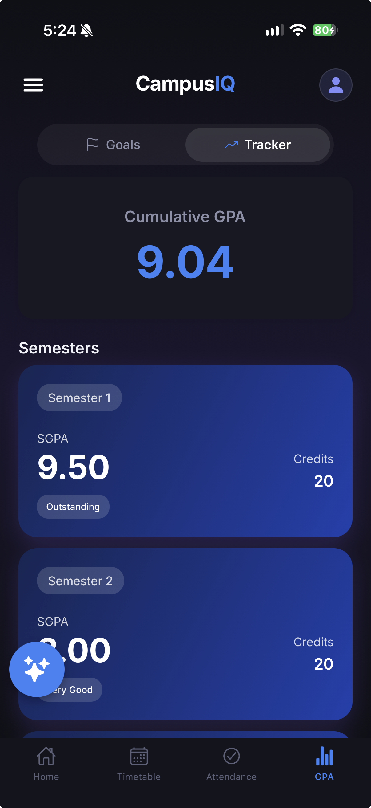</td>
  </tr>
</table>
</details>

<details>
<summary><strong>🎯 Goals, course overview and academic tools</strong></summary>
<br />
<table>
  <tr><th>Semester goals</th><th>Goals in dark mode</th><th>Course overview</th><th>Academic Hub</th></tr>
  <tr>
    <td></td>
    <td>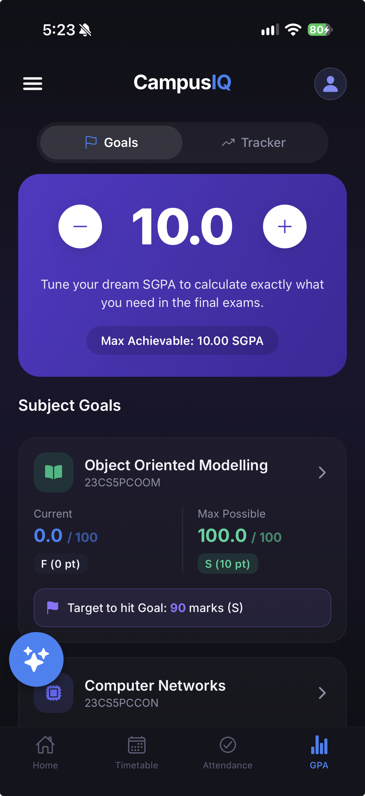</td>
    <td></td>
    <td>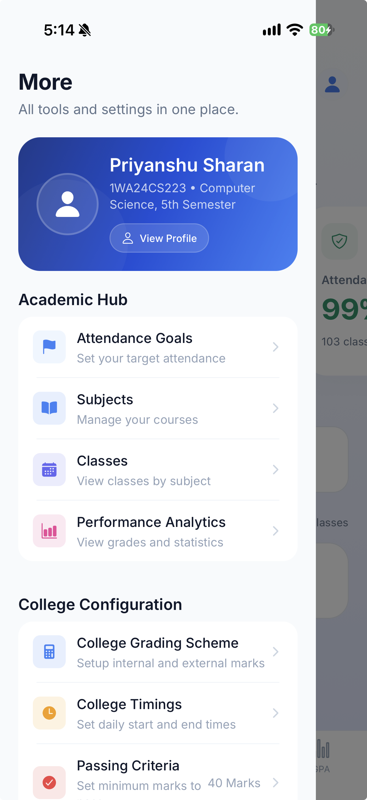</td>
  </tr>
</table>
</details>

<details>
<summary><strong>✨ AI chat, connections, settings and About</strong></summary>
<br />
<table>
  <tr><th>Academic chat</th><th>Dark-mode chat</th><th>AI connections</th></tr>
  <tr>
    <td></td>
    <td></td>
    <td>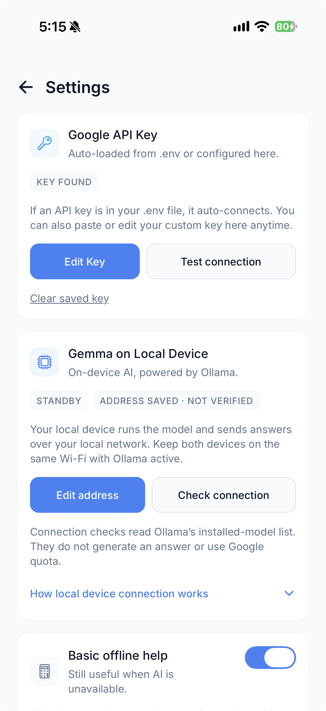</td>
  </tr>
</table>
<table>
  <tr><th>App settings</th><th>About CampusIQ</th></tr>
  <tr>
    <td align="center">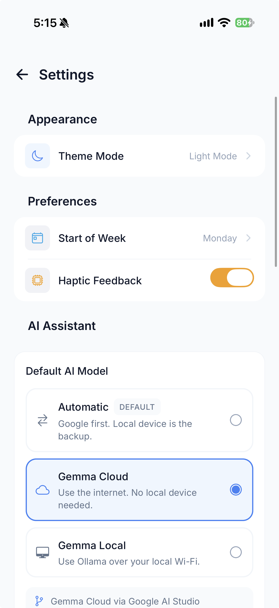</td>
    <td align="center">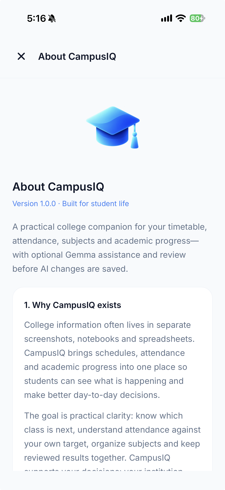</td>
  </tr>
</table>
</details>

<details>
<summary><strong>👤 Profile — light and dark</strong></summary>
<br />
<table>
  <tr>
    <td align="center"></td>
    <td align="center"></td>
  </tr>
</table>
</details>

<sub>Screenshots show example records and the app state when captured. Displayed marks and attendance are not benchmark results or guaranteed outcomes. <a href="hacktoberfest-screenshots">Browse the screenshot files →</a></sub>


## 🤖 Choose where Gemma runs

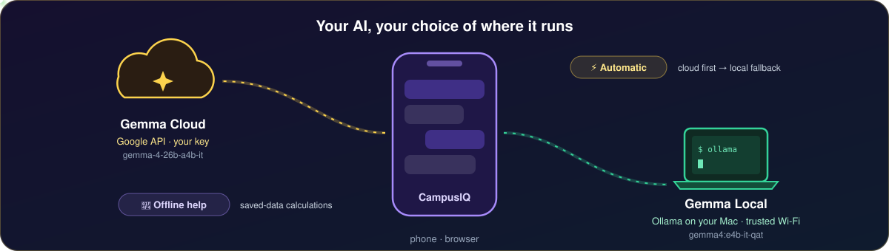

| Mode | Request path | What you need |
| :--- | :--- | :--- |
| ☁️ **Gemma Cloud** | Phone/browser → Google API | Internet and a Google API key with access and quota for the configured model. No Mac required. |
| 💻 **Gemma Local** | Phone/browser → your Ollama endpoint | A reachable machine running the local model; typically your Mac on trusted Wi-Fi. |
| ⚡ **Automatic** | Cloud first, then enabled local fallback | Cloud credentials and an optional working local connection. |
| 📴 **Basic offline help** | Saved-data calculations | The offline-help setting enabled. Labelled separately; it does not read images or prepare AI imports. |

The current model identifiers are `gemma-4-26b-a4b-it` for Google and `gemma4:e4b-it-qat` for Ollama. The app always shows which provider answered. A Mac-hosted model is **not** an on-iPhone model.

Cloud and local replies can stream. Closing AI chat cancels its active transport, and repeated model-output loops are stopped early. Provider processing or quota charges may still occur after cancellation. Cloud rate limits and model availability depend on your provider project.


## 🚀 Run CampusIQ

### Prerequisites

| Tool | Notes |
| :--- | :--- |
| **Node.js 22** | Matches the Render build (`NODE_VERSION=22.16.0`). |
| **npm** | Uses the committed `package-lock.json` via `npm ci`. |
| **Xcode / Android Studio** | Only for native development builds. |
| **Ollama** *(optional)* | Only for Gemma Local. |

### 1 · Install

```bash
git clone https://github.com/priyanshusharan-cmd/campusiq.git
cd campusiq
npm ci
```

### 2 · Start development

```bash
npm start
```

For a native development build:

```bash
npm run ios
# or
npm run android
```

Native builds need the usual platform toolchain and device/simulator setup. Native image paste uses `expo-paste-input`; it requires a rebuilt custom app and cannot be added to Expo Go through a JavaScript reload. Photo selection remains an alternative on builds without that module.

### 3 · Configure optional AI

Open **Settings → AI Assistant**, save your Google API key, choose the mode and test the connection when needed. A successful text test does not guarantee a later image import will work.

For local Gemma on your Mac:

```bash
ollama pull gemma4:e4b-it-qat
OLLAMA_HOST=0.0.0.0:11434 ollama serve
```

If Ollama is already running, configure that instance rather than starting a second server on the same port. In the app, enter your Mac's trusted-network address, for example `http://192.168.1.52:11434`. Keep the machine awake and reachable.

> [!CAUTION]
> Do not expose an unauthenticated Ollama endpoint to the public internet.

See [Gemma setup and connection troubleshooting](docs/GEMMA_SETUP.md) for the full guide.

### 4 · Browser preview

```bash
npm run build:web
npm run preview:web
```

A user-entered browser API key stays in page memory and clears on reload. Native user-saved keys use Expo SecureStore. An HTTPS-hosted browser may block an HTTP connection to your local Mac; use a compatible local setup or the native app for that route.


## 🌐 Put it online with Render

Connect this repository in **Render → New → Static Site**, then use:

| Setting | Value |
| :--- | :--- |
| Branch | `main` |
| Root directory | Leave blank |
| Build command | `npm ci && npm run build:web` |
| Publish directory | `dist` |
| Environment | `NODE_VERSION=22.16.0` |
| Rewrite | `/*` → `/index.html` |

The included [`render.yaml`](render.yaml) also supports Blueprint deployment. After deploying, open the published URL and test navigation, a page refresh, local record persistence and an optional cloud connection. Enter AI credentials in the app's Settings; never embed private keys in the frontend build. See the [full deployment guide](docs/RENDER_DEPLOYMENT.md).


## 🔒 Privacy, plainly

| Stays on your device | Leaves your device (only when you use AI) |
| :--- | :--- |
| Timetable, subjects, attendance, grades, goals | Your message and recent chat context |
| All attendance and GPA calculations | Relevant saved academic information |
| Settings and preferences | Attached source images |
| Native API keys (Expo SecureStore) | — sent **only** to the provider you selected |

Core academic records live in app/browser storage, and ordinary calculations run locally. Local Ollama sends AI requests to the machine you configured; cloud processing sends them to Google.

Review what you attach, use a trusted endpoint, and keep credentials out of screenshots and commits. Provider policies govern provider-side processing and retention. Exports and backups create independent copies. The in-app [Privacy Policy source](src/app/%28modals%29/privacy-policy.tsx) documents current storage, permissions, AI routing, key handling and deletion behavior.


## 🏗️ Architecture

One shared application serves iOS, Android and the browser. Academic calculations and saved records stay local; optional AI requests travel directly to the chosen provider. Render serves the browser build without running a model or an application backend.

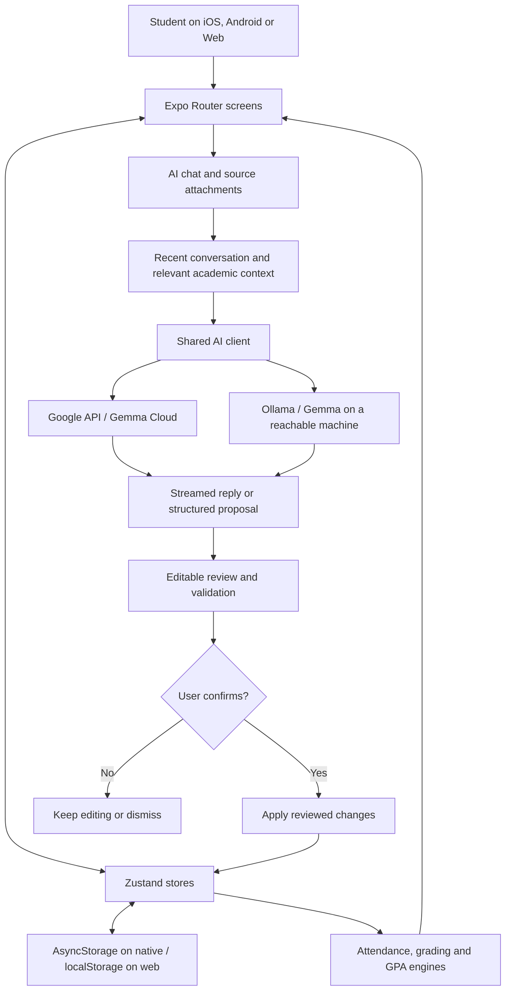

### How an import becomes saved data

| Stage | Responsibility |
| :--- | :--- |
| **1 · Source & context** | Send the selected image, request, relevant records and recent conversation to the chosen provider. |
| **2 · Extraction** | Request structured subject, class or result fields rather than relying on a prose promise. |
| **3 · Normalization** | Reuse matching subjects, clean exact duplicates and resolve uniquely ordered time headers. |
| **4 · Validation** | Identify missing fields, overlaps, ambiguous mappings and replacement scope before saving. |
| **5 · Review** | Let the student correct rows, approve suggested lab mappings and confirm the destination semester. |
| **6 · Apply** | Update the relevant stores after confirmation; saving uses a coordinated plan with rollback on failure. |

### Deployment and data boundaries

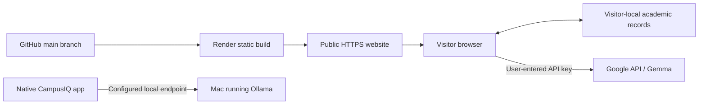

There is no shared hosted database or bundled public AI key. Each visitor has separate browser records and supplies their own key for cloud AI. A shared-key experience would need an additional backend with private credentials and usage controls. HTTPS browser access to local Ollama depends on browser security and endpoint configuration.


## 🧰 Tech stack

<p align="center">
  
</p>

| Layer | Technology | Role in CampusIQ |
| :--- | :--- | :--- |
| **App runtime** | Expo SDK 57 · React Native 0.86 · React 19 | Shared mobile and browser application. |
| **Language** | TypeScript 6 | Typed models, action proposals and academic logic. |
| **Navigation** | Expo Router · React Navigation | File-based routes, tabs, drawers and modal screens. |
| **State** | Zustand · Immer | Academic records, settings, profile and coordinated updates. |
| **Persistence** | AsyncStorage · browser localStorage | Local records with platform-specific storage adapters. |
| **Cloud AI** | Gemma via Google API | Optional streamed answers and document extraction. |
| **Local AI** | Gemma via Ollama | Optional inference on a reachable configured machine. |
| **Motion & visuals** | Reanimated · LinearGradient · Expo icons · SVG · Gifted Charts | Animated details, themed cards and academic visualizations. |
| **Images & documents** | Expo Image Picker · Document Picker · Clipboard · native paste | Source attachments and supported file/image input. |
| **Device features** | SecureStore · Notifications · Local Authentication | Native credential storage and supported device integrations. |
| **Export** | Expo Print · Sharing · browser adapters | Reports, downloads and supported sharing workflows. |
| **Dates & calendars** | date-fns · React Native Calendars · date/time pickers | Weekly schedules, dated classes and attendance calendars. |
| **Web hosting** | React Native Web · Expo export · Render Static Site | A browser build published from `dist`. |
| **Checks** | TypeScript · Node test runner | Mocked AI tests, academic-engine checks and platform validation. |


## 🗂️ Repository map

```text
campusiq/
├── src/
│   ├── app/                  Routes: tabs, onboarding, modals, settings, analytics
│   │   ├── (tabs)/           Home · Schedule · Attendance · GPA
│   │   ├── (onboarding)/     Welcome · Profile · Subjects
│   │   └── (modals)/         Campus AI, forecaster, grading wizard, creators…
│   ├── features/
│   │   ├── ai/               Chat, streaming, extraction, action review and saving
│   │   ├── timetable/        Schedule views and time tools
│   │   ├── academics/        GPA tracking and forecasting
│   │   ├── today/            Home dashboard
│   │   └── attendance/ assignments/ exams/ analytics/ profile/ settings/ onboarding/
│   ├── lib/                  Pure academic engines (attendance, grades, grading, PDF)
│   ├── stores/               Persisted Zustand state
│   ├── platform/             Native / browser adapters
│   ├── components/ theme/    Shared UI and design tokens
│   └── types/ utils/         Shared types and helpers
├── tests/                    Node test-runner suites (mocked AI, engines, web)
├── docs/                     Gemma, Render, web validation, dependency security
├── scripts/                  Web build & preview
├── assets/                   App icons and README graphics
└── hacktoberfest-screenshots/  Screens used in this README
```


## 🧪 Quality checks

```bash
npx tsc --noEmit                                  # type-check
node --test tests/*.test.mjs tests/*.test.cjs     # test suites
npm run build:web                                 # production web build
```

| Suite | Covers |
| :--- | :--- |
| `gemma-client` | Provider routing, streaming, cancellation and fallbacks |
| `gemma-actions` | Imports, review validation, replacement scopes and scorecards |
| `gemma-image-drop` · `gemma-format` | Image handling and output formatting |
| `academic-engine` | Attendance and grade calculations |
| `web-adapters` · `web-layout` | Browser storage/adapters and responsive layout |
| `dependency-security` | Dependency policy checks |

AI tests use mocked providers and **do not consume Google quota**. Mocked tests verify application logic; they do not guarantee the accuracy of live model extraction.


## ❓ FAQ

<details>
<summary><strong>Do I need an API key to use CampusIQ?</strong></summary>
<br />
No. Timetable, attendance, grades, forecasting and exports all work without AI. A key (or a local Ollama setup) is only needed for chat and image imports.
</details>

<details>
<summary><strong>Does Gemma run on my phone?</strong></summary>
<br />
No. Gemma Local runs on a machine you control (typically your Mac) and the phone connects to it over your network. Gemma Cloud runs on Google's API.
</details>

<details>
<summary><strong>Will an AI import overwrite my data?</strong></summary>
<br />
Not without your confirmation. Every import becomes an editable proposal; you choose the semester and replacement scope, and saving rolls back if anything fails.
</details>

<details>
<summary><strong>Is my data uploaded to a server?</strong></summary>
<br />
Your records stay in app or browser storage. Data leaves the device only when you send an AI request, and only to the provider you selected.
</details>

<details>
<summary><strong>Can I use it with my college's grading scheme?</strong></summary>
<br />
Yes. The grading wizard and grading settings let you configure grade boundaries and internal/external maximum marks, and all GPA math follows that scheme.
</details>


## 🤝 Contributing

Contributions are welcome!

1. **Fork** the repo and create a branch: `git checkout -b feat/your-idea`
2. **Keep changes focused** on one fix or feature.
3. **Run the checks** in [Quality checks](#-quality-checks) before opening a PR.
4. **Open a pull request** that describes the problem and how you validated the fix.

For document-extraction bugs, include a small **redacted** example and explain the expected interpretation. Found a bug? [Open an issue →](https://github.com/priyanshusharan-cmd/campusiq/issues)


## 📚 Go deeper

| Guide | What's inside |
| :--- | :--- |
| [Gemma setup](docs/GEMMA_SETUP.md) | Cloud keys, Ollama setup, verification and troubleshooting |
| [Render deployment](docs/RENDER_DEPLOYMENT.md) | Static-site and Blueprint deployment |
| [Web validation](docs/WEB_VALIDATION.md) | Browser checks before release |
| [Dependency security](docs/DEPENDENCY_SECURITY.md) | Dependency policy and audit notes |


## 👨‍💻 Built by a student, for student life

<table>
  <tr>
    <td align="center" width="160">
      <a href="https://github.com/priyanshusharan-cmd"></a>
      <br /><strong>Priyanshu Sharan</strong>
    </td>
    <td>
      CS engineering student at BMS College of Engineering, Bangalore. CampusIQ started as a fix for my own semester and placed <strong>3rd at Hacktoberfest 2026</strong>.
      <br /><br />
      <a href="https://github.com/priyanshusharan-cmd"></a>
      <a href="https://linkedin.com/in/priyanshusharan"></a>
    </td>
  </tr>
</table>

CampusIQ is licensed under the **[MIT License](LICENSE)**. Model weights, dependencies and third-party services have their own licenses and terms. CampusIQ is not an official college system or an endorsement by the model providers.

<div align="center">

<br />

**Plan your week. Understand your progress. Keep the final say.**

If CampusIQ helps you, consider giving it a ⭐ — it really helps!

[Back to top ↑](#)

</div>
