<div align="center">


# CampusIQ

### Your semester. Your schedule. Your next move.

A college companion that turns scattered timetables, attendance records, and marksheets into a clearer picture of student life—with **Gemma AI you can use in the cloud or on your Mac**.


[Explore the app](#a-look-inside) · [What it does](#built-around-your-semester) · [AI workflow](#from-a-screenshot-to-a-reviewable-proposal) · [Architecture](#architecture) · [Tech stack](#tech-stack) · [Run locally](#run-campusiq) · [Documentation](#go-deeper)

</div>

---

## A look inside

<table>
  <tr>
    <th>Start with your day</th>
    <th>See your schedule</th>
    <th>Stay on track</th>
  </tr>
  <tr>
    <td align="center"></td>
    <td align="center"></td>
    <td align="center">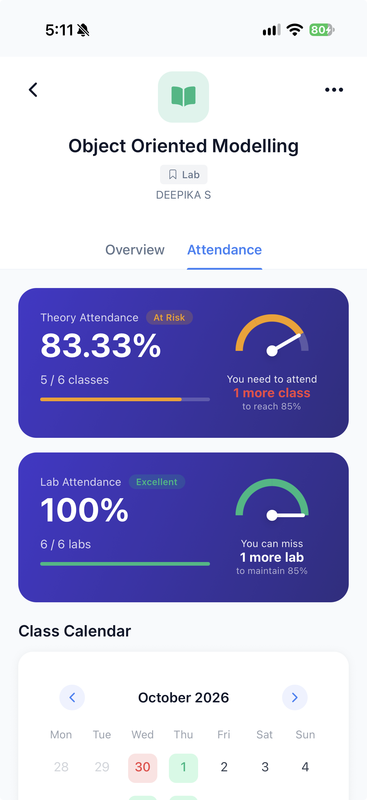</td>
  </tr>
</table>

**Less hunting through screenshots. More understanding what comes next.**

CampusIQ connects the practical parts of college life: the class you need to attend, the attendance target you want to maintain, and the grades you are working toward. Add information manually, or ask AI to prepare an import—then review it before anything changes.

## Built around your semester

| Area | What you can do |
| :--- | :--- |
| **Home** | Check academic stats, open your core tools, and see today's classes at a glance. |
| **Timetable** | Organize Monday–Sunday schedules, lecture and lab slots, rooms, weekly classes, and dated extras. |
| **Subjects & Classes** | Keep course details together and browse classes grouped by subject in Academic Hub. |
| **Attendance** | Track present, absent, cancelled, and holiday records; inspect subject-level theory/lab attendance and targets. |
| **SGPA & CGPA** | Maintain semester scorecards with course codes, credits, marks, and grade points; track cumulative progress. |
| **Grade forecasting** | Explore assessment components, subject goals, score projections, and each course's effect on SGPA. |
| **AI assistance** | Ask academic questions, attach a timetable or marksheet, and prepare supported app changes with conversation context. |
| **Personalization** | Choose light/dark appearance, course colors and icons, college timings, attendance targets, and grading settings. |

Assignments, exams, calendar exceptions, exports, and supported device reminders round out the toolkit. Availability of device services varies by platform.

## From a screenshot to a reviewable proposal

<table>
  <tr><th>Ask naturally</th><th>Enable app changes</th><th>Review the details</th></tr>
  <tr>
    <td align="center"></td>
    <td align="center">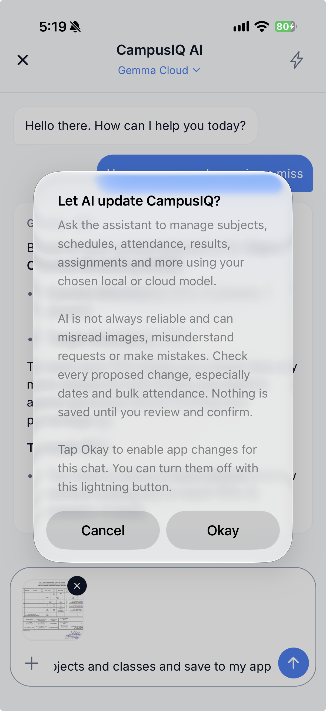</td>
    <td align="center"></td>
  </tr>
</table>

1. **Attach the source.** Choose a photo, use supported image paste, or paste/drop an image in the browser. JPEG, PNG, and WebP images are supported up to 3 MB.
2. **Say what you need.** For example: “Add the subjects and faculty from this timetable,” “Update my weekly classes,” or “Import this marksheet into Semester 3.” No special command syntax is required.
3. **Enable the lightning control** for app changes. Ordinary questions can stay in regular chat.
4. **Review the proposal.** Check the semester, extracted fields, lecture/lab slots, suggested mappings, and any unresolved conflicts. Date/time pickers make manual corrections explicit.
5. **Confirm and save.** The assistant prepares changes; the app validates and applies the reviewed proposal.

### Helpful automation, with the final say in your hands

- **Reuses saved courses** through names, codes, and unique abbreviations rather than requiring duplicate subjects.
- **Keeps lecture and lab sessions distinct**, with confirmation for suggested lab-to-course mappings.
- **Checks ordered time headers** to resolve an unambiguous noon rollover when AM/PM is missing; ambiguous periods remain reviewable.
- **Cleans exact duplicates and explicit time formats** without shifting a class to conceal a real conflict.
- **Shows issue counts and an Issues only filter**, so you can find the rows that need attention.
- **Replaces the selected semester's schedule** with a choice of weekly-only or weekly-plus-dated scope.
- **Imports marksheet course rows independently** of the current Subjects list, including explicitly printed zero-credit courses. Zero credits do not contribute to GPA weighting.
- **Uses recent chat context and the latest shared image** for follow-ups while the chat remains open.

Supported proposals also include class edits, attendance ranges, assignment and exam updates, semester results, calendar exceptions, and allowlisted profile/preferences changes. Credentials, security controls, sharing, app-wide resets, and custom grading configuration stay outside chat control.

> **AI can make mistakes.** A section, batch, merged cell, faculty name, or grading rule can be misread. CampusIQ leaves genuine ambiguities for review rather than claiming that every document is understood perfectly. A chat explanation is not proof that data was saved.

## Grades you can explore

<table>
  <tr><th>Your semester story</th><th>Your course forecast</th><th>Every point has context</th></tr>
  <tr>
    <td align="center">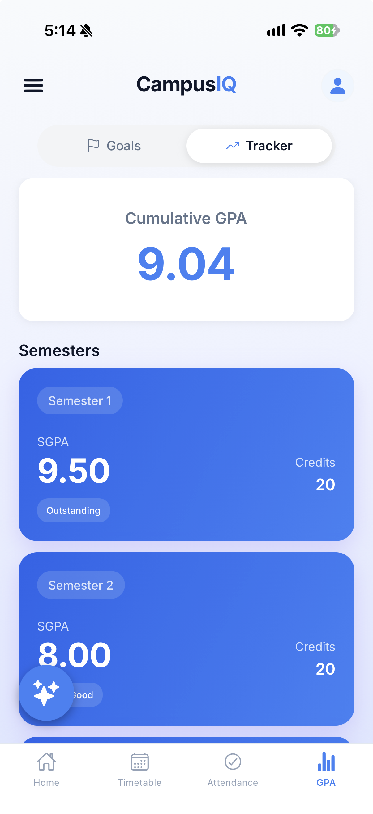</td>
    <td align="center"></td>
    <td align="center">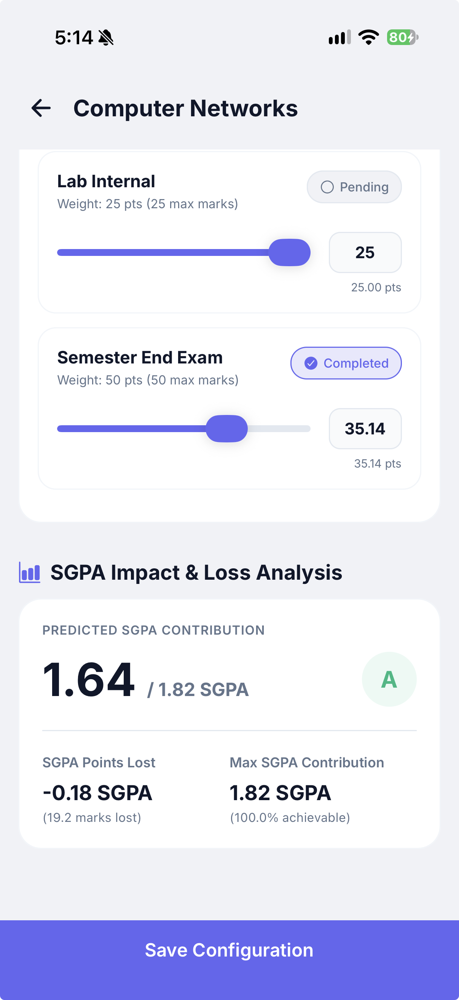</td>
  </tr>
</table>

Keep a course-by-course record, explore a target, and understand how a subject contributes to your semester. GPA calculations use the configured grading scheme and reviewed data; projections are estimates, not official college results.

## More screens, two personalities

<details>
<summary><strong>☀️ Light & 🌙 dark — Home, Attendance, Timetable, and GPA</strong></summary>
<br />
<table>
  <tr><th>Home</th><th>Attendance</th><th>Timetable</th><th>CGPA</th></tr>
  <tr>
    <td></td>
    <td>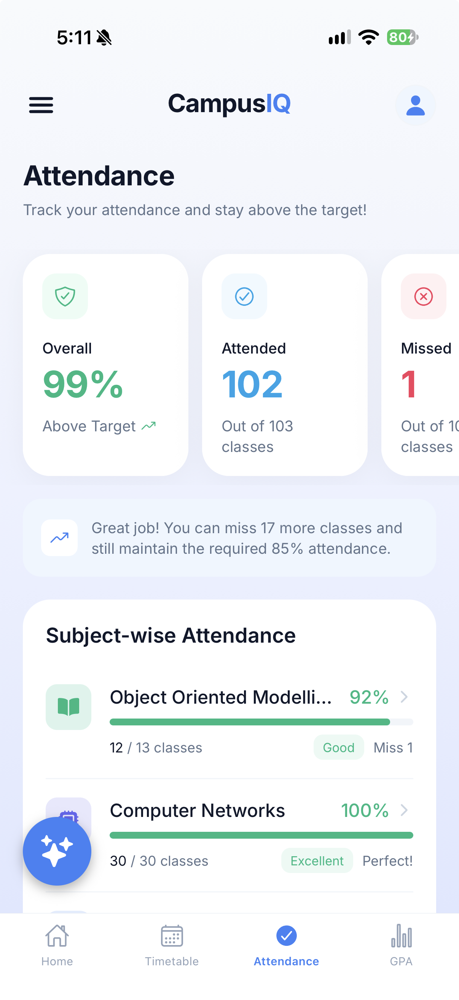</td>
    <td>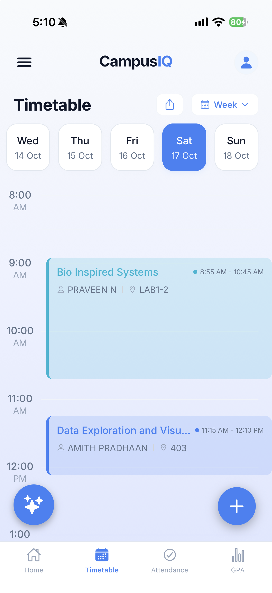</td>
    <td></td>
  </tr>
  <tr>
    <td>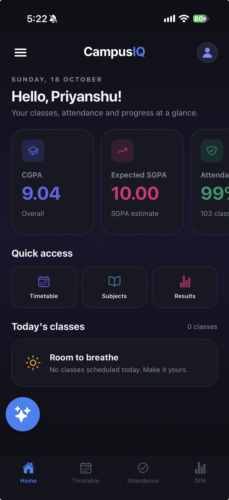</td>
    <td>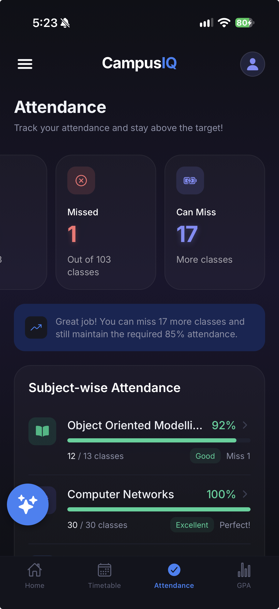</td>
    <td></td>
    <td></td>
  </tr>
</table>
</details>

<details>
<summary><strong>🎯 Goals, course overview, and academic tools</strong></summary>
<br />
<table>
  <tr><th>Semester goals</th><th>Goals in dark mode</th><th>Course overview</th><th>Academic Hub</th></tr>
  <tr>
    <td>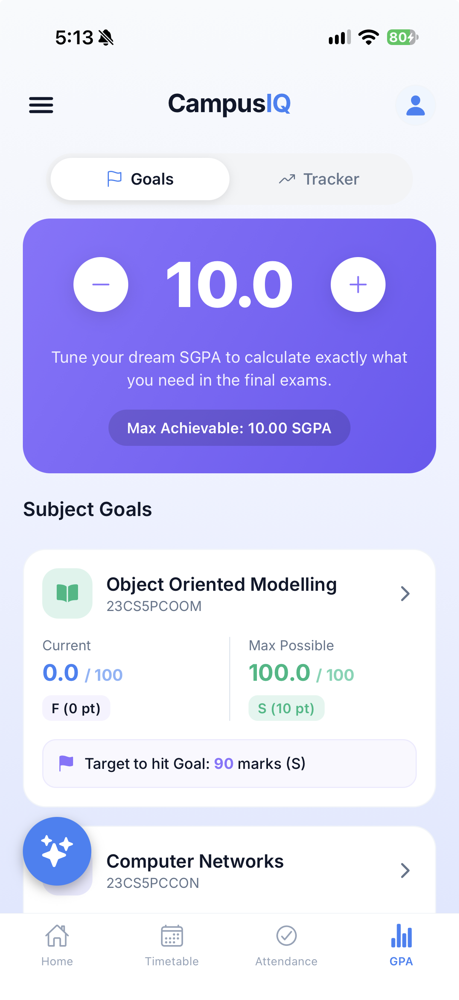</td>
    <td></td>
    <td>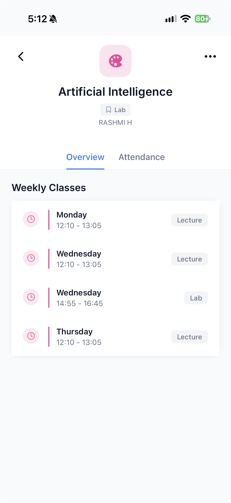</td>
    <td></td>
  </tr>
</table>
</details>

<details>
<summary><strong>✨ AI chat, connections, settings, and About</strong></summary>
<br />
<table>
  <tr><th>Academic chat</th><th>Dark-mode chat</th><th>AI connections</th></tr>
  <tr>
    <td>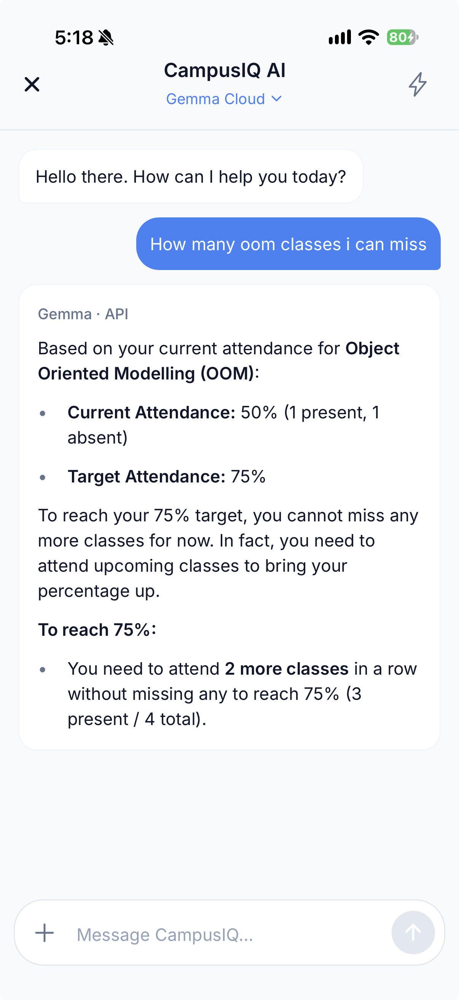</td>
    <td>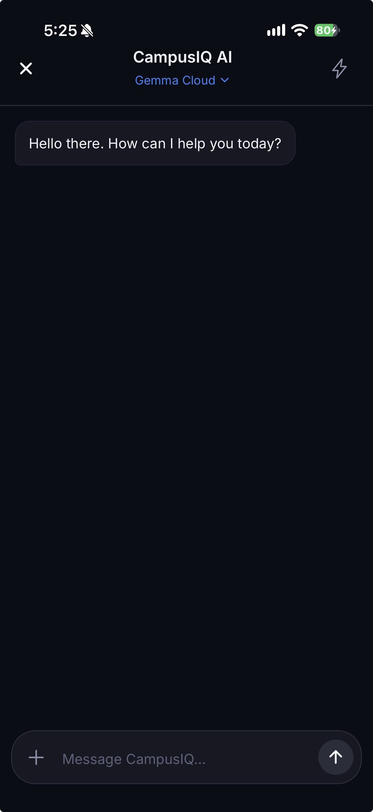</td>
    <td></td>
  </tr>
</table>
<table>
  <tr><th>App settings</th><th>About CampusIQ</th></tr>
  <tr>
    <td align="center"></td>
    <td align="center"></td>
  </tr>
</table>
</details>

<details>
<summary><strong>👤 Profile — light and dark</strong></summary>
<br />
<table>
  <tr>
    <td align="center">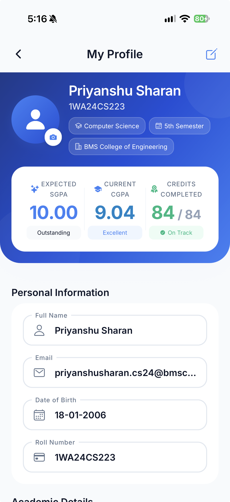</td>
    <td align="center">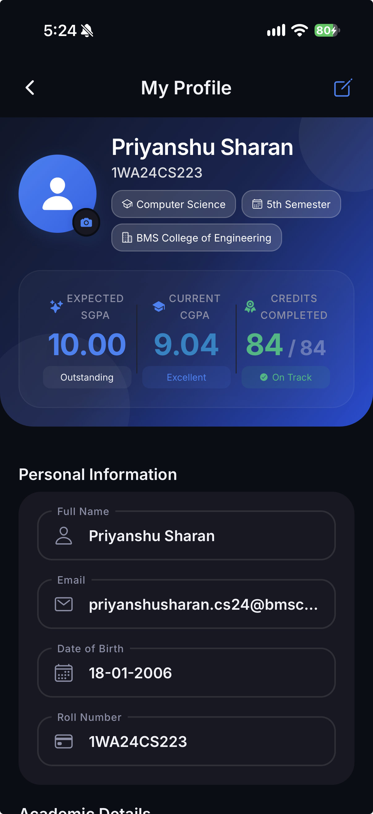</td>
  </tr>
</table>
</details>

Screenshots show example records and the app state when captured. Displayed marks and attendance are not benchmark results or guaranteed outcomes. [Browse the screenshot files →](hacktoberfest-screenshots)

## Choose where Gemma runs

| Mode | Request path | What you need |
| :--- | :--- | :--- |
| **Gemma Cloud** | Phone/browser → Google API | Internet and a Google API key with access and quota for the configured model. No Mac required. |
| **Gemma Local** | Phone/browser → your Ollama endpoint | A reachable configured machine running the local model; typically your Mac on trusted Wi-Fi. |
| **Automatic** | Cloud first, then enabled local fallback | Cloud credentials and an optional working local connection. |
| **Basic offline help** | Saved-data calculations | Enabled offline-help setting. This is labelled separately and does not read images or prepare AI imports. |

The current model identifiers are `gemma-4-26b-a4b-it` for Google and `gemma4:e4b-it-qat` for Ollama. The app shows which provider answered. A Mac-hosted model is **not** an on-iPhone model.

Cloud and local replies can stream. Closing AI chat cancels its active transport, and repeated model-output loops are stopped early. Provider processing or quota charges may still occur after cancellation. Cloud rate limits and model availability depend on your provider project.

## Run CampusIQ

### 1 · Install

```bash
git clone https://github.com/priyanshusharan-cmd/hacktoberfest-2026.git
cd hacktoberfest-2026
npm ci
```

### 2 · Start development

```bash
npm start
```

For a native development build:

```bash
npm run ios
# or
npm run android
```

Native builds need the usual platform toolchain and device/simulator setup. Native image paste uses `expo-paste-input`; it requires a rebuilt custom app and cannot be added to Expo Go through a JavaScript reload. Photo selection remains an alternative on builds without that module.

### 3 · Configure optional AI

Open **Settings → AI Assistant**, save your Google API key, choose the mode, and test the connection when needed. A successful text test does not guarantee a later image import will work.

For local Gemma on your Mac:

```bash
ollama pull gemma4:e4b-it-qat
OLLAMA_HOST=0.0.0.0:11434 ollama serve
```

If Ollama is already running, configure that instance rather than starting a second server on the same port. In the app, enter your Mac's trusted-network address, for example `http://192.168.1.52:11434`. Keep the machine awake and reachable. Do not expose an unauthenticated Ollama endpoint to the public internet.

See [Gemma setup and connection troubleshooting](docs/GEMMA_SETUP.md) for the full guide.

### Browser preview

```bash
npm run build:web
npm run preview:web
```

A user-entered browser API key stays in page memory and clears on reload. Native user-saved keys use Expo SecureStore. An HTTPS-hosted browser may block an HTTP connection to your local Mac; use a compatible local setup or the native app for that route.

## Put it online with Render

Connect this repository in **Render → New → Static Site**, then use:

| Setting | Value |
| :--- | :--- |
| Branch | `main` |
| Root directory | Leave blank |
| Build command | `npm ci && npm run build:web` |
| Publish directory | `dist` |
| Environment | `NODE_VERSION=22.16.0` |
| Rewrite | `/*` → `/index.html` |

The included [`render.yaml`](render.yaml) also supports Blueprint deployment. After deployment, open the published URL and test navigation, a page refresh, local record persistence and an optional cloud connection. Enter AI credentials in the app's Settings; do not embed private keys in the frontend build. See the [full deployment guide](docs/RENDER_DEPLOYMENT.md).

## Privacy, plainly

Core academic records live in app/browser storage, and ordinary calculations run locally. **Optional AI requests send your message, recent context, relevant saved academic information, and attached source images to the selected destination.** Local Ollama sends that information to the configured machine; cloud processing sends it to Google.

Review what you attach, use a trusted endpoint, and keep credentials out of screenshots and commits. Provider policies govern provider-side processing and retention. Exports and backups create independent copies. The in-app [Privacy Policy source](src/app/%28modals%29/privacy-policy.tsx) documents current storage, permissions, AI routing, key handling, and deletion behavior.

## Architecture

One shared application serves iOS, Android, and the browser. Academic calculations and saved records stay local; optional AI requests travel directly to the chosen provider. Render serves the browser build without running a model or an application backend.

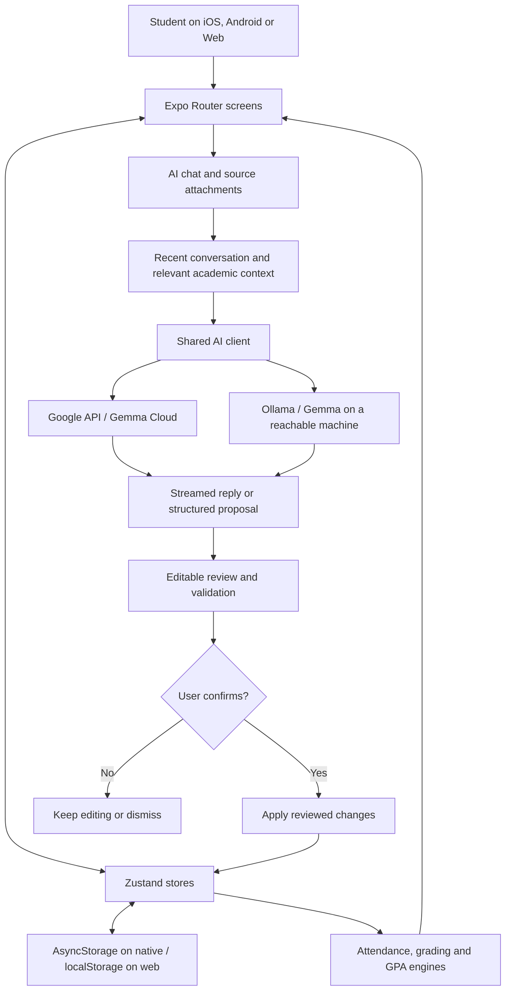

### How an import becomes saved data

| Stage | Responsibility |
| :--- | :--- |
| **Source & context** | Send the selected image, request, relevant records and recent conversation to the chosen provider. |
| **Extraction** | Request structured subject, class or result fields rather than relying on a prose promise. |
| **Normalization** | Reuse matching subjects, clean exact duplicates and resolve uniquely ordered time headers. |
| **Validation** | Identify missing fields, overlaps, ambiguous mappings and replacement scope before saving. |
| **Review** | Let the student correct rows, approve suggested lab mappings and confirm the destination semester. |
| **Apply** | Update the relevant stores after confirmation; saving uses a coordinated plan with rollback on failure. |

### Deployment and data boundaries

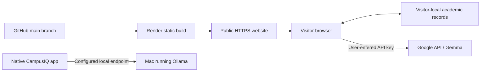

There is no shared hosted database or bundled public AI key in this setup. Each visitor has separate browser records and supplies a key for cloud AI. A shared-key experience would require an additional backend with private credentials and usage controls. HTTPS browser access to local Ollama depends on browser security and endpoint configuration.

## Tech stack

| Layer | Technology | Role in CampusIQ |
| :--- | :--- | :--- |
| **App runtime** | Expo SDK 57 · React Native 0.86 · React 19 | Shared mobile and browser application. |
| **Language** | TypeScript 6 | Typed models, action proposals and academic logic. |
| **Navigation** | Expo Router · React Navigation | File-based routes, tabs, drawers and modal screens. |
| **State** | Zustand · Immer | Academic records, settings, profile and coordinated updates. |
| **Persistence** | AsyncStorage · browser localStorage | Local records with platform-specific storage adapters. |
| **Cloud AI** | Gemma via Google API | Optional streamed answers and document extraction. |
| **Local AI** | Gemma via Ollama | Optional inference on a reachable configured machine. |
| **Motion & visuals** | Reanimated · LinearGradient · Expo icons · SVG · Gifted Charts | Animated details, themed cards and academic visualizations. |
| **Images & documents** | Expo Image Picker · Document Picker · Clipboard · native paste | Source attachments and supported file/image input. |
| **Device features** | SecureStore · Notifications · Local Authentication | Native credential storage and supported device integrations. |
| **Export** | Expo Print · Sharing · browser adapters | Reports, downloads and supported sharing workflows. |
| **Dates & calendars** | date-fns · React Native Calendars · date/time pickers | Weekly schedules, dated classes and attendance calendars. |
| **Web hosting** | React Native Web · Expo export · Render Static Site | A browser build published from `dist`. |
| **Checks** | TypeScript · Node test runner | Mocked AI tests, academic-engine checks and platform validation. |

### Repository map

```text
src/app/                  Routes and modal screens
src/features/ai/          Chat, streaming, extraction, action review and saving
src/features/timetable/   Schedule views and time tools
src/features/academics/   GPA tracking and forecasting
src/features/today/       Home dashboard
src/stores/               Persisted app state
src/lib/                  Shared academic logic
src/platform/             Native/browser adapters
hacktoberfest-screenshots/ App screenshots used in this README
tests/                    Automated checks
```

## Check your changes

```bash
npx tsc --noEmit
node --test tests/*.test.mjs tests/*.test.cjs
npm run build:web
```

AI tests use mocked providers and **do not consume Google quota**. They exercise provider routing, streaming, cancellation, image handling, imports, review validation, replacement scopes, grade calculations, and scorecard behavior. Mocked tests verify application logic; they do not guarantee the accuracy of live model extraction.

## Go deeper

- [Gemma setup and verification](docs/GEMMA_SETUP.md)
- [Static web deployment](docs/RENDER_DEPLOYMENT.md)
- [Browser validation](docs/WEB_VALIDATION.md)
- [Dependency security notes](docs/DEPENDENCY_SECURITY.md)
- [Report a bug](https://github.com/priyanshusharan-cmd/hacktoberfest-2026/issues)

## Built by a student, for student life

Created by **Priyanshu Sharan**. Contributions are welcome: describe the issue, keep changes focused, and include relevant validation. For document-extraction bugs, provide a small redacted example and explain the expected interpretation.

CampusIQ is licensed under the **[MIT License](LICENSE)**. Model weights, dependencies, and third-party services have their own licenses and terms. CampusIQ is not an official college system or an endorsement by the model providers.

<div align="center">

**Plan your week. Understand your progress. Keep the final say.**

[Back to top ↑](#campusiq)

</div>
